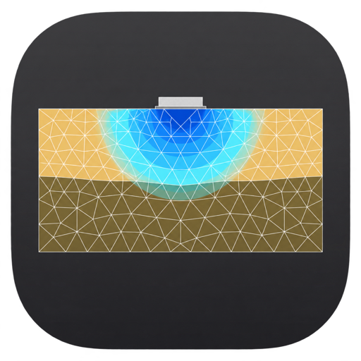
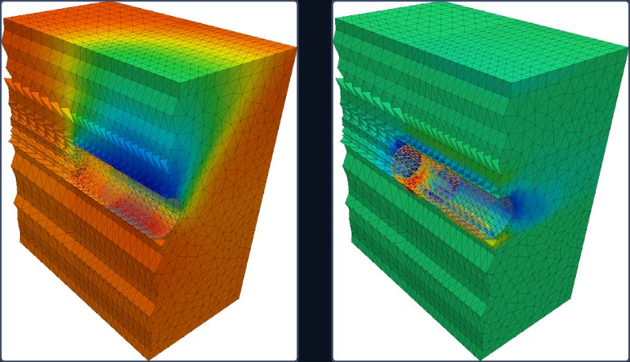
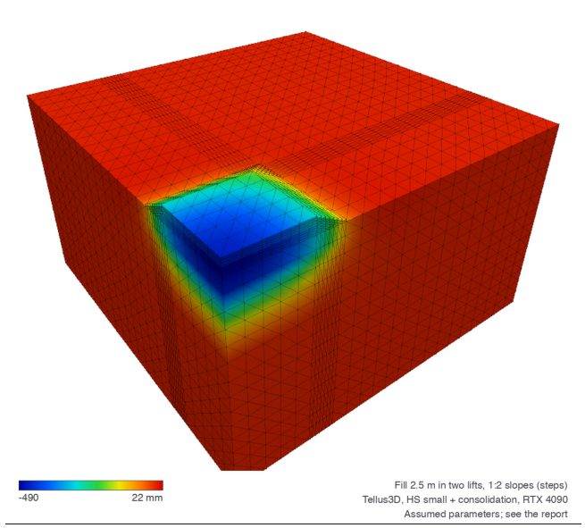

<p align="center">
  
</p>

# Tellus3D: download and licence

Tellus3D is a three-dimensional geotechnical finite element program for engineers. It builds
and calculates excavations, embankments on soft ground, foundations and TBM tunnels with
staged construction, consolidation and safety analysis, and its chat assistant can build a
3D model from a description in English or Thai. This repository holds the ready-built
program for macOS and Windows. Tellus3D runs on a subscription, so it needs a licence key,
which you activate once on each computer.

**Quick start.** Download the program for your system from the [Download](#download)
section, e-mail [tellusfem@gmail.com](mailto:tellusfem@gmail.com) for a Tellus3D licence
key, and paste the key into the activation screen the first time Tellus3D starts.
Activation needs the internet once, and after that Tellus3D runs on your computer like any
desktop program. A key for Tellus (the plane-strain program) does not unlock Tellus3D,
because the two programs are licensed separately.



## What Tellus3D does

Tellus3D covers the three-dimensional finite element work of a geotechnical engineer in one
program, and it runs entirely on your own computer, so a calculation needs no other FE
software or network service once the licence is active. You build a model in the
**Input** workspace, calculate it with the built-in solver, and read the results in
**Output**, whereas the **Chat assistant** can do the same steps from a description in
words. The same model can also be driven by AI assistants such as Claude and ChatGPT
through Tellus3D's MCP server ([Step 4](#step-4-optional-connect-claude-or-chatgpt-through-mcp)),
so an assistant and an engineer can work on one project file.

**Modelling.** The model is a box in plan with z upwards. The soil comes from one or more
boreholes, each with its plan position, top level and layer thicknesses, and the layer
boundaries are interpolated in plan between them, so strata may slope and thin out. Soil
volumes over the layers model excavations, embankments and replaced soil, and the mesh of
10-node tetrahedra follows the layer surfaces and the volume and load planes, so every
element lies inside one soil zone.

**Soil models.** Tellus3D offers linear elastic, Mohr-Coulomb with dilatancy and a tension
cut-off, Hardening Soil and HS small for stiffness that depends on stress and strain, and
Soft Soil and Soft Soil Creep for soft clays. Each soil is drained or undrained, with its
own horizontal and vertical permeability.

**Structures, tunnels and drains.** Plates model walls and slabs as shell elements, either
tied to the soil or joined to it by interface elements with Coulomb strength. Embedded
piles carry load by skin friction and base resistance. A TBM tunnel is driven ring by ring,
with one phase per ring for the face pressure, the shield, the grout in the tail void, the
segment lining and the jack thrust. Prefabricated vertical drains and vacuum preloading can
be modelled drain by drain or as an equivalent permeability of the treated zone.

**Construction stages and groundwater.** The initial stresses come from the K0 procedure or
gravity loading, and each later phase can switch soil volumes, structures and loads on or
off and change the water level. Phases are plastic, consolidation (coupled Biot
consolidation over a time in days) or Safety (φ-c reduction), and Soft Soil Creep creeps
over the duration of a phase.

**Results.** Output shows any phase in 3D as a deformed mesh or as contours of
displacement, effective stress, pore pressure, excess pore pressure and plastic points,
and a section cut opens the model so the inside can be read. A Safety phase reports its
factor of safety, and the structures report their forces and moments. Tellus3D also writes
a PDF report of the model and its results.



**Chat assistant.** The Chat assistant opens beside the model, so the model stays in view
while you describe a problem, for example "a 10 m by 10 m raft on 5 m of medium sand over
soft clay carries 80 kPa, the water table is 1 m down; what is the settlement after one
year?". Tellus3D then builds the model, calculates it and answers with the solver's
numbers, shows pictures of the results under its reply and writes a PDF report when asked.
Every change goes into the model on screen as an ordinary edit, so you can check, correct
and undo it. The assistant works in Thai as well as English, and it uses the **TigrimOS
agent**, an LLM agent that plans its own steps with all of Tellus3D's tools. The agent
needs an API key for its language model, which you enter under **Settings** in the chat
panel, and this key is separate from the Tellus3D licence.
[Step 3](#step-3-optional-set-up-the-chat-agent) explains how to set it up.

**Files.** Projects are saved as `.tellus3d` files, which hold the whole model as readable
JSON.

## Download

| System | File | Notes |
|---|---|---|
| macOS 11 or later, Intel or Apple Silicon | [`macos/Tellus3D-0.1.0-macos-universal.dmg`](macos/Tellus3D-0.1.0-macos-universal.dmg) | Open the DMG and drag **Tellus3D** into **Applications**. |
| Windows 10 or 11, 64-bit | [`windows/Tellus3D-0.1.0-windows-x64.zip`](windows/Tellus3D-0.1.0-windows-x64.zip) | Unzip the folder anywhere and run `Tellus3D.exe`. Keep `tigrim.exe` beside it, because the chat assistant uses it. |

The programs are not signed by a registered developer, so the system warns you the first
time. On macOS, right-click **Tellus3D** in Applications, choose **Open**, and confirm with
**Open**. On Windows, choose **More info** and then **Run anyway** when SmartScreen
appears. A 3D calculation needs much more memory than a plane-strain one, so 8 GB of
memory is the minimum for ordinary models and 16 GB or more is advisable for fine meshes
and tunnel drives.

## Step 1: get a licence key

Ask for a key by e-mail to **[tellusfem@gmail.com](mailto:tellusfem@gmail.com)** and give
these details, because the key is issued in your name and limited to a number of
computers:

- your full name,
- your affiliation (university or company),
- your e-mail address,
- how many computers will run Tellus3D,
- the plan you need (academic, standard or trial).

You will receive a key of the form `T3D-XXXX-XXXX-XXXX-XXXX-XXXX`. Keep it private,
because anyone with the key could use one of your seats.

## Step 2: activate Tellus3D

Start Tellus3D while connected to the internet. The first screen asks for the key, so
paste it into the box and click **Activate**. Upper or lower case and spaces do not
matter. Tellus3D checks the key with the licence server and opens the normal workspace,
and the top bar then shows who the copy is licensed to, which confirms that activation
worked.

## Step 3 (optional): set up the chat agent

The chat assistant is optional, because every model can also be built by hand in Input.
We recommend a model from **OpenRouter**, a service that gives one API key for many AI
models and charges per use, for example **DeepSeek V4.1 Flash**
(`deepseek/deepseek-v4.1-flash-1017`), which is fast and cheap. Payment for the model goes
to OpenRouter and is separate from the Tellus3D subscription.

**Get an OpenRouter key.**

1. Sign up at [openrouter.ai](https://openrouter.ai) with an e-mail, Google or GitHub
   account.
2. Add credit under **Settings → Credits**, because paid models need a balance.
3. Open [openrouter.ai/keys](https://openrouter.ai/keys), click **Create Key**, give it a
   name such as "Tellus3D", and copy the key, which starts with `sk-or-v1-`. OpenRouter
   shows it only once, so paste it into Tellus3D straight away or keep it somewhere safe.

**Enter it in Tellus3D.**

1. Click **Chat assistant** at the top right and then **Settings** in the chat panel.
2. Leave **tigrim** empty, because Tellus3D finds the agent program that comes with it.
3. Fill in the three fields:

   | Field | Value |
   |---|---|
   | API URL | `https://openrouter.ai/api/v1` |
   | Model | `deepseek/deepseek-v4.1-flash-1017` |
   | API key | your OpenRouter key (`sk-or-v1-…`) |

4. Click **Save key** and then **Done**. The key stays on your computer, in your user
   settings folder, and Tellus3D gives it only to the agent.

**Python for the agent** is optional. When Python with numpy is installed, Tellus3D finds
it and the agent may use it for numbers, such as a hand check of a result, and without it
the agent still works. The **Agent workspace** is the only folder the agent may write to.

Now describe a problem in the chat. The agent builds the model on screen, calculates it
and answers with the solver's numbers, and each of its changes can be checked and undone.
Because a 3D calculation can take minutes, the agent starts with a coarse mesh and offers
a finer one once the model is right. Other OpenRouter models also work, as do other
providers with an OpenAI-compatible API, when you change the URL and the model. The model
must support tool calling, and a weak model makes more mistakes in building the model, so
check its results as you would a junior engineer's.

## Step 4 (optional): connect Claude or ChatGPT through MCP

Tellus3D can also be driven from an AI assistant outside the program, such as Claude
Desktop, Claude Code, the ChatGPT desktop app or Codex, through the Model Context Protocol
(MCP). The command `tellus3d --mcp` starts Tellus3D without a window as an MCP server that
the assistant launches on your computer and talks to over stdin and stdout. Its tools build
a model, calculate it, read the results and write reports, so a request such as "model a
6 m deep excavation supported by a diaphragm wall in soft clay and give me the wall
deflection" is answered with the solver's numbers. The server uses the same licence as the
program, so activate Tellus3D first ([Step 2](#step-2-activate-tellus3d)), and it works on
ordinary `.tellus3d` files, so a project the assistant saves opens in Tellus3D for
checking.

Each assistant needs the full path of the Tellus3D program:

| System | Path of the program |
|---|---|
| macOS | `/Applications/Tellus3D.app/Contents/MacOS/tellus3d` |
| Windows | the full path of `Tellus3D.exe`, for example `C:\Tools\Tellus3D\Tellus3D.exe` (written `C:\\Tools\\Tellus3D\\Tellus3D.exe` inside JSON) |

**Claude Desktop.** Open **Settings → Developer → Edit Config**, which opens
`claude_desktop_config.json` (in `~/Library/Application Support/Claude` on macOS and
`%APPDATA%\Claude` on Windows). Add Tellus3D under `mcpServers`, save the file and restart
Claude Desktop:

```json
{
  "mcpServers": {
    "tellus3d": {
      "command": "/Applications/Tellus3D.app/Contents/MacOS/tellus3d",
      "args": ["--mcp"]
    }
  }
}
```

**Claude Code.** Register the server once for your user account, and the tools load in
the next session, where `/mcp` lists them:

```sh
claude mcp add -s user tellus3d -- /Applications/Tellus3D.app/Contents/MacOS/tellus3d --mcp
```

**ChatGPT desktop app and Codex.** These start local MCP servers from one shared file,
`~/.codex/config.toml` (`%USERPROFILE%\.codex\config.toml` on Windows). Add Tellus3D with
`codex mcp add tellus3d -- /Applications/Tellus3D.app/Contents/MacOS/tellus3d --mcp`, or
write the entry into the file by hand:

```toml
[mcp_servers.tellus3d]
command = "/Applications/Tellus3D.app/Contents/MacOS/tellus3d"
args = ["--mcp"]
```

**Options and checks.** To start with a project loaded, add it to the arguments, for
example `["--mcp", "--open", "/path/to/pit.tellus3d"]`, and add `"--autosave",
"/path/to/pit.tellus3d"` to save the model there after every change, so you can open the
file in Tellus3D to see what the assistant built. If the tools answer that Tellus3D is not
activated, run the program path with `--licence` in a terminal to confirm the licence
state. The model you choose in Claude or ChatGPT is paid for under your own Anthropic or
OpenAI account, separately from the Tellus3D subscription.

## Licence details and moving to another computer

Click the **Licensed to …** label in the top bar to see the key, the plan, the end of the
subscription and how long Tellus3D may run offline. **Check now** asks the server again,
for example after your subscription was renewed. **Deactivate this computer** frees the
seat, so you can activate the same key on a new computer. Deactivate before you replace or
reinstall a computer, because a seat stays taken until it is released.

## Working offline

Activation needs the internet once. After that Tellus3D runs without a connection for up
to 30 days, and it checks the key with the server about every 7 days whenever it can. If
Tellus3D has been offline for longer than 30 days, it asks for the key again, and
connecting to the internet and clicking **Activate** restores it. When the subscription
ends or the key is withdrawn, Tellus3D shows the activation screen at its next check, but
your project files stay yours and open again once the licence is renewed.

## Activating from the command line

IT staff who install Tellus3D on many computers can activate without opening the program:

```sh
# macOS
/Applications/Tellus3D.app/Contents/MacOS/tellus3d --activate T3D-XXXX-XXXX-XXXX-XXXX-XXXX
/Applications/Tellus3D.app/Contents/MacOS/tellus3d --licence      # shows the holder, plan and expiry
/Applications/Tellus3D.app/Contents/MacOS/tellus3d --deactivate   # frees this computer's seat

# Windows (Command Prompt, in the Tellus3D folder)
Tellus3D.exe --activate T3D-XXXX-XXXX-XXXX-XXXX-XXXX
Tellus3D.exe --licence
Tellus3D.exe --deactivate
```

On Windows the result appears just after the prompt returns, because `Tellus3D.exe` is a
windowed program, so press **Enter** once to get a clean prompt again.

## When activation fails

| Message | What it means and what to do |
|---|---|
| This licence key is not known. | The key was mistyped, or it is a key for Tellus rather than Tellus3D. Paste the Tellus3D key again from the e-mail. |
| All N seat(s) of this licence are in use. | The key is active on as many computers as it allows. Deactivate one of them, or ask for more seats. |
| This subscription expired on … | The subscription has ended. Ask to renew it, then click **Activate** again. |
| This licence key has been revoked. | The key was withdrawn. Write to tellusfem@gmail.com. |
| Cannot reach the licence server | The computer is offline, or a firewall or proxy blocks the connection. Connect to the internet and try again, or ask IT to allow the licence server (below). |
| The computer's clock is earlier than when Tellus3D last ran | The system date was set back. Correct the date and time. |

The licence is stored in your user folder (`~/Library/Application Support/Tellus3D` on
macOS and `%APPDATA%\Tellus3D` on Windows), so each user account on a shared computer
activates separately. The key is tied to the computer, so copying the licence file to
another computer does not work.

## For IT staff

Tellus3D contacts only its licence server over HTTPS (port 443), and it does so at
activation, at deactivation and for the check about every 7 days. The calculations
themselves run on the computer and send nothing over the network. The chat assistant is
the one exception, because its agent calls the API provider whose key the user enters
under **Settings**. A university or company network that filters outgoing traffic
therefore needs to allow the licence server, whose address we give on request at
[tellusfem@gmail.com](mailto:tellusfem@gmail.com), and, if the chat assistant is used, the
chosen API provider.

## Help

Write to [tellusfem@gmail.com](mailto:tellusfem@gmail.com) for a key, a renewal, more
seats, or any problem with activation. Please include the message Tellus3D shows and, for
activation problems, the output of `tellus3d --licence`, which names the computer and its
licence state.
